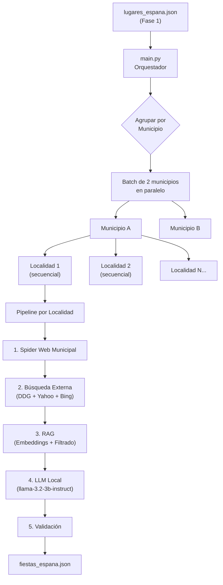
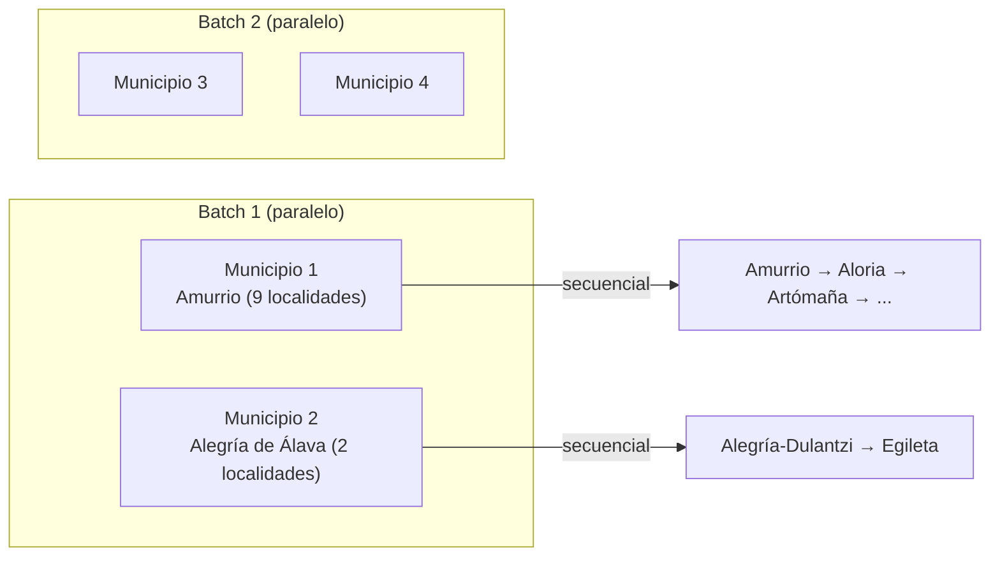

# Fase 2: Extracción de Fiestas — Cómo Funciona

## Visión General

La Fase 2 toma como entrada el JSON de lugares de España generado en la Fase 1 (`lugares_espana.json`) y, para cada localidad (pueblo, barrio, distrito, ciudad...), busca automáticamente sus fiestas en internet, las extrae con una IA local y las guarda en `fiestas_espana.json`.

## Diagrama de Flujo General

---

## Archivos y su Función

| Archivo | Función |
|---|---|
| [main.py](file:///c:/Users/Usuario/PROYECTOS/DEV-FIESTYFY_0426/FIESTYFY_algorithm/Algoritmo_fiestas/Fase2_Extraccion_Fiestas/main.py) | **Orquestador principal.** Carga datos, agrupa municipios, lanza batches en paralelo y coordina todo el pipeline |
| [config.py](file:///c:/Users/Usuario/PROYECTOS/DEV-FIESTYFY_0426/FIESTYFY_algorithm/Algoritmo_fiestas/Fase2_Extraccion_Fiestas/config.py) | **Configuración centralizada.** Todos los parámetros ajustables: modelos, timeouts, concurrencia, etc. |
| [state_manager.py](file:///c:/Users/Usuario/PROYECTOS/DEV-FIESTYFY_0426/FIESTYFY_algorithm/Algoritmo_fiestas/Fase2_Extraccion_Fiestas/state_manager.py) | **Persistencia.** Guarda progreso atómicamente (tmp → rename) para poder reanudar si se interrumpe |
| [heuristic_spider.py](file:///c:/Users/Usuario/PROYECTOS/DEV-FIESTYFY_0426/FIESTYFY_algorithm/Algoritmo_fiestas/Fase2_Extraccion_Fiestas/scraper/heuristic_spider.py) | **Spider de 2 pasadas.** Rastrea la web del ayuntamiento buscando páginas de fiestas |
| [google_search.py](file:///c:/Users/Usuario/PROYECTOS/DEV-FIESTYFY_0426/FIESTYFY_algorithm/Algoritmo_fiestas/Fase2_Extraccion_Fiestas/scraper/google_search.py) | **Buscador externo multi-motor.** Busca en DuckDuckGo, Yahoo y Bing con rotación aleatoria |
| [document_extractor.py](file:///c:/Users/Usuario/PROYECTOS/DEV-FIESTYFY_0426/FIESTYFY_algorithm/Algoritmo_fiestas/Fase2_Extraccion_Fiestas/scraper/document_extractor.py) | **OCR y PDFs.** Extrae texto de imágenes (carteles) y PDFs (programas de fiestas) |
| [text_analyzer.py](file:///c:/Users/Usuario/PROYECTOS/DEV-FIESTYFY_0426/FIESTYFY_algorithm/Algoritmo_fiestas/Fase2_Extraccion_Fiestas/llm_processor/text_analyzer.py) | **RAG + LLM.** Filtra texto por relevancia con embeddings y llama a la IA local para extraer las fiestas |

---

## Pipeline Detallado (por localidad)

### Paso 1: Spider Web Municipal 🕷️
**Archivo:** [heuristic_spider.py](file:///c:/Users/Usuario/PROYECTOS/DEV-FIESTYFY_0426/FIESTYFY_algorithm/Algoritmo_fiestas/Fase2_Extraccion_Fiestas/scraper/heuristic_spider.py)

Si el municipio tiene `sitio_web` (ej. `https://amurrio.eus/cas`), el spider hace **2 pasadas**:

**Pasada 1 — Mapeo y Puntuación (BFS)**
- Empieza desde la URL del ayuntamiento y rastrea enlaces con un algoritmo BFS (Breadth-First Search)
- Escanea hasta **1.000 páginas** (configurable en `SPIDER_MAX_MAPPING_PAGES`)
- Cada página recibe una **puntuación de relevancia** basada en:
  - +500 puntos si menciona el nombre de la localidad
  - +100 puntos por keywords fuertes ("programa de fiestas", "fiestas patronales", "verbena"...)
  - +20 puntos por keywords débiles ("fiesta", "concierto", "romería"...)
  - -100 puntos por contenido institucional ("presupuesto", "pleno", "urbanismo"...)
- También recopila los enlaces a PDFs e imágenes que encuentra

**Pasada 2 — Extracción Profunda**
- Toma las **70 mejores páginas** (por puntuación) y las procesa en detalle
- Para cada página:
  - Descarga PDFs prometedores (que contengan palabras como "programa", "cartel", "fiesta") y les extrae el texto con `pdfplumber`
  - Descarga imágenes prometedoras (que parezcan carteles de fiestas, no logos ni iconos) y les aplica **OCR con Tesseract** para leer el texto del cartel
  - Filtra agresivamente: excluye logos, iconos, favicons, imágenes pequeñas (<300x200px), etc.

### Paso 2: Búsqueda Externa 🔍
**Archivo:** [google_search.py](file:///c:/Users/Usuario/PROYECTOS/DEV-FIESTYFY_0426/FIESTYFY_algorithm/Algoritmo_fiestas/Fase2_Extraccion_Fiestas/scraper/google_search.py)

Lanza **3 consultas** de búsqueda por localidad, por ejemplo para "Amurrio":
1. `"fiestas patronales Amurrio Amurrio 2026"`
2. `"programa fiestas Amurrio 2026"`
3. `"fiestas Amurrio Araba/Álava 2026"`

Cada consulta se envía a uno de los **3 motores de búsqueda** (elegido al azar):
- **DuckDuckGo** (HTML)
- **Yahoo** España
- **Bing**

Medidas anti-bloqueo:
- Rotación aleatoria de **User-Agents** (Chrome, Firefox, Safari, Edge)
- **Jitter aleatorio** (espera entre 1-3.5 segundos entre peticiones)
- **Failover automático**: si un motor falla, el reintento va a otro motor distinto

Después sigue las **5 mejores URLs** de los resultados para descargar el contenido completo de las noticias/webs de fiestas.

### Paso 3: RAG (Retrieval-Augmented Generation) 📊
**Archivo:** [text_analyzer.py](file:///c:/Users/Usuario/PROYECTOS/DEV-FIESTYFY_0426/FIESTYFY_algorithm/Algoritmo_fiestas/Fase2_Extraccion_Fiestas/llm_processor/text_analyzer.py) — clase `AsyncRAGProcessor`

Todo el texto recopilado (del spider + búsquedas) puede ser enorme (>100.000 caracteres), pero la IA local solo puede procesar ~8.000 tokens. Aquí entra el RAG:

1. **Fragmentación (Chunking):** Corta el texto en trozos de 1.200 caracteres con 200 de solapamiento
2. **Vectorización:** Envía todos los fragmentos al modelo de embeddings local (`text-embedding-nomic-embed-text-v1.5`) en batches de 20
3. **Búsqueda semántica:** Compara cada fragmento con la consulta "Fiestas y programas de actos en [municipio] para [localidad] en [año]" usando similitud coseno
4. **Saturación de contexto:** Selecciona los fragmentos más relevantes hasta llenar ~8.000 tokens (~26.400 caracteres)

### Paso 4: Inferencia LLM (IA Local) 🤖
**Archivo:** [text_analyzer.py](file:///c:/Users/Usuario/PROYECTOS/DEV-FIESTYFY_0426/FIESTYFY_algorithm/Algoritmo_fiestas/Fase2_Extraccion_Fiestas/llm_processor/text_analyzer.py) — función `analyze_festivals_for_locality`

Se envía el texto filtrado al modelo **llama-3.2-3b-instruct:2** en LM Studio con un prompt que incluye:

- **System prompt** con el criterio de fiestas (qué cuenta como fiesta y qué no)
- **Regla de exclusividad**: si es la capital del municipio, solo extraer fiestas del núcleo principal; si es una pedanía, solo fiestas de esa pedanía específica
- **Formato JSON estricto** que debe devolver: nombre, fechas, tamaño, descripción, programa de actos...

> [!IMPORTANT]
> La IA tiene un **semáforo global** (`asyncio.Semaphore(1)`) que garantiza que **solo una petición** llega a LM Studio a la vez, evitando desbordar la VRAM de la GPU.

### Paso 5: Validación Post-LLM ✅
**Archivo:** [text_analyzer.py](file:///c:/Users/Usuario/PROYECTOS/DEV-FIESTYFY_0426/FIESTYFY_algorithm/Algoritmo_fiestas/Fase2_Extraccion_Fiestas/llm_processor/text_analyzer.py) — función `validar_fiestas`

El JSON que devuelve la IA se valida rigurosamente:
1. Campos obligatorios presentes (nombre, fecha_inicio, fecha_fin)
2. `lugar_id` coincide con la localidad real (detecta alucinaciones)
3. Fechas en formato `YYYY-MM-DD` y del año correcto (2026)
4. `fecha_inicio <= fecha_fin` (si no, las intercambia)
5. Genera un slug/ID si falta o es inválido
6. **Deduplicación** por nombre normalizado + fecha de inicio

---

## Orquestación y Paralelismo

- **Entre municipios**: 2 municipios se procesan **en paralelo** (`asyncio.gather`)
- **Dentro de un municipio**: las localidades se procesan **secuencialmente** (comparten la misma web municipal, no tiene sentido rastrearla en paralelo)
- **Guardado**: solo al terminar **todas** las localidades de un municipio se escribe en el JSON

---

## Persistencia y Reanudación

El `StateManager` permite parar y reanudar el script sin perder progreso:
- Usa **escritura atómica** (escribe en `.tmp` y luego hace `os.replace`)
- Guarda qué municipios ya están completados en `municipios_completados[]`
- Al reiniciar, filtra los municipios ya procesados y continúa desde donde se quedó

---

## Configuración Actual

| Parámetro | Valor | Descripción |
|---|---|---|
| Modelo LLM | `llama-3.2-3b-instruct:2` | Modelo de chat en LM Studio |
| Modelo Embeddings | `text-embedding-nomic-embed-text-v1.5` | Modelo de vectorización |
| Paralelismo | 2 municipios | Municipios procesados simultáneamente |
| Spider páginas | 1.000 | Páginas máximas rastreadas por web municipal |
| Spider top | 70 | Mejores páginas para extracción profunda |
| RAG tokens | 8.000 | Contexto máximo para la IA |
| Buscadores | DuckDuckGo, Yahoo, Bing | Rotación aleatoria con failover |
| Temperatura LLM | 0.0 | Sin creatividad, para evitar alucinaciones |
