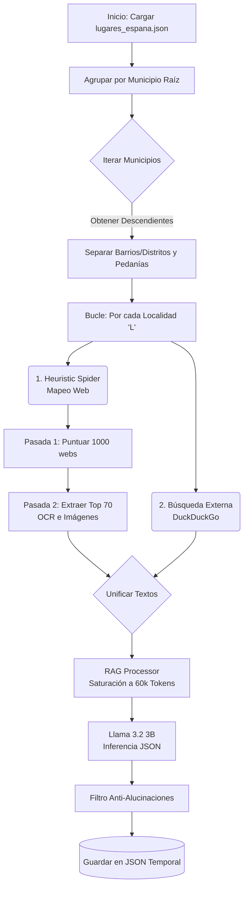

# Informe Detallado: Funcionamiento de la Fase 2 (Extracción de Fiestas)

La **Fase 2** del Algoritmo Fiestyfy es un sistema automatizado de Inteligencia Artificial enfocado en extraer, filtrar y estructurar información sobre fiestas locales en España. Su objetivo principal es generar un archivo `fiestas_espana.json` limpio y libre de alucinaciones, focalizándose **exclusivamente en las localidades menores** (barrios, distritos y pedanías) y nunca en el municipio raíz.

---

## 🏗️ Arquitectura General (Locality-Centric)

El orquestador divide el problema aislando cada localidad. En lugar de procesar un municipio de golpe, lanza un hilo de ejecución independiente por cada subdivisión (primero barrios/distritos, luego pedanías), garantizando un contexto estanco y puro para cada lugar.

---

## ⚙️ Desglose Esquematizado por Módulos

### 1. `main.py` y `state_manager.py` (El Orquestador)
- **Carga de Datos**: Interpreta el archivo generado en la Fase 1, leyendo tanto los `padre_id` como `abuelo_id` (para no dejar fuera a barrios que cuelgan de distritos).
- **Procesamiento Secuencial**: Ataca a las localidades una a una. 
- **Persistencia Segura**: Tras procesar un municipio entero, guarda el progreso utilizando un archivo `.tmp` que luego sobrescribe al principal. Esto evita que los datos se corrompan si se cierra la terminal bruscamente.

### 2. `scraper/heuristic_spider.py` (El Crawler de Dos Pasadas)
El rastreador de la web del ayuntamiento (`M.sitio_web`) no funciona a ciegas, actúa como un rastreador estratégico para no saturar al servidor y ahorrar tiempo.

* **Pasada 1 (Mapeo y Puntuación - Ligera):**
  * Navega por los enlaces del ayuntamiento (hasta **1000 páginas**).
  * Respeta un límite de **8 clics de profundidad** interna y **3 clics** hacia enlaces externos.
  * Solo lee el HTML y asigna una **puntuación**. Recibe **+500 puntos** si la página menciona explícitamente el nombre de la localidad 'L' (barrio/pedanía actual), priorizándola brutalmente sobre otras páginas.
* **Pasada 2 (Extracción Pesada - Agresiva):**
  * Ordena el ranking y selecciona las **70 mejores páginas**.
  * Solo en estas 70 páginas activa los motores de descarga para bajar carteles, imágenes grandes y archivos PDFs.

### 3. `scraper/document_extractor.py` (Módulo OCR)
Cuando el Spider en su "Pasada 2" encuentra documentos, delega la extracción de texto a este módulo.
* **Para PDFs**: Utiliza `pdfplumber` para mantener la estructura de columnas y tablas de los programas de fiestas. Si detecta que es un PDF escaneado (imágenes sin texto nativo), lo procesa como imagen.
* **Para Imágenes (Carteles)**: Utiliza **Tesseract OCR** (`pytesseract`) de forma local para extraer el texto directamente de los píxeles de los carteles. 

### 4. `scraper/google_search.py` (Búsqueda Complementaria)
En paralelo a la web oficial, lanza una petición a DuckDuckGo HTML buscando específicamente: `fiestas [Localidad] [Municipio] [Año]`. Recupera los títulos y los resúmenes (snippets) de los primeros resultados para atrapar noticias de periódicos locales.

### 5. `llm_processor/text_analyzer.py` (El Cerebro RAG y LLM)
Toda la masa de texto generada por el HTML de 70 páginas, los PDFs, el OCR de los carteles y la búsqueda en Google, suma cientos de miles de caracteres ruidosos.

* **Sistema RAG (Generación Aumentada por Recuperación):**
  * Fragmenta todo el texto en pequeños *chunks* de 1500 caracteres.
  * Llama al modelo de Embeddings en **LM Studio** para vectorizar cada fragmento.
  * Ordena los fragmentos calculando la **similitud de coseno** respecto a la pregunta: *"Fiestas y programas de actos en [Municipio] para la localidad de [Localidad]"*.
  * Acumula los mejores fragmentos hasta **saturar un límite de 60.000 tokens**.
* **El LLM (Llama 3.2 3B):**
  * Recibe un bloque gigante, puro y ordenado de 60.000 tokens sobre esa localidad específica.
  * Su *System Prompt* tiene reglas draconianas: se le prohíbe inventar fiestas para el municipio raíz, obligándole a asignar los eventos exclusivamente al ID de la localidad consultada.

### 6. Control Anti-Alucinaciones
Como filtro final, el programa en Python lee el JSON devuelto por Llama 3B. Si la IA intenta colar una fiesta cuyo `lugar_id` no coincide de forma exacta con la localidad evaluada, el programa descarta automáticamente esa fiesta y emite un aviso por consola.

---

## 📈 Resumen de Tiempos y Rendimiento
Al separar el análisis por localidad, una pedanía compleja puede tardar entre **2 y 5 minutos** en procesarse (Mapear 1000 páginas, descargar documentos de 70 páginas, hacer OCR, vectorizar y esperar respuesta del LLM). La exhaustividad de esta arquitectura garantiza que no se escapen carteles perdidos ni PDFs escondidos en la web de un ayuntamiento.
